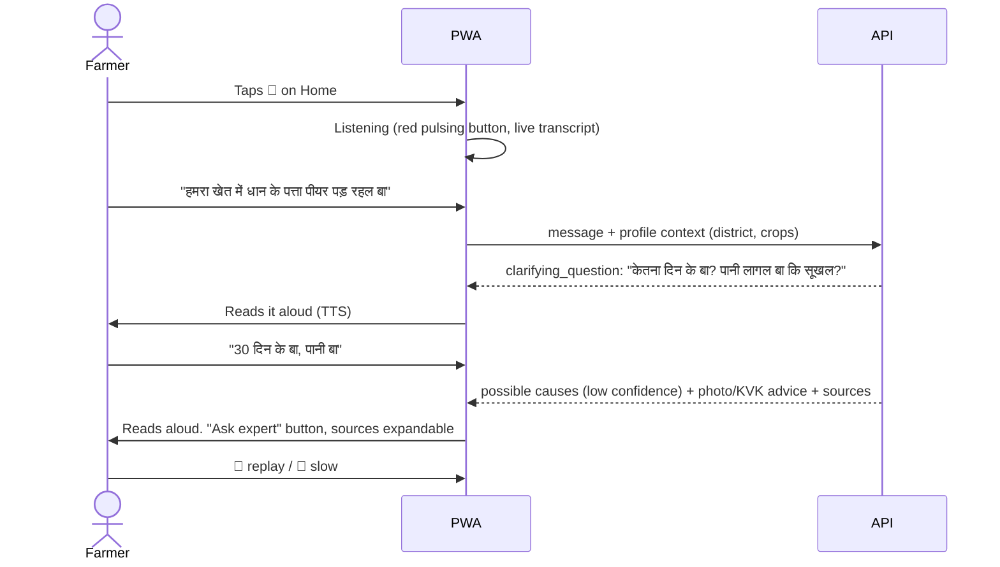

# 6. User Journeys & Workflows · 7. UI/UX Wireframes

## 6.1 Journey: crop problem by voice (Ramesh, Bhojpuri)



## 6.2 Journey: mandi price
Home → 💰 → crop pre-selected from profile, district from profile → cards (market, modal ₹/qtl, min/max, **price date**) → "🔊 सुनीं" → disclaimer + source. By voice: "आज मुजफ्फरपुर में मक्का का भाव का बा?" → assistant reads the top 3 markets with dates.
**Offline:** shows the last saved result inside a yellow "पुराना – आज का नहीं" box, or says nothing is saved.

## 6.3 Journey: scheme eligibility (Sunita)
Speaks "सरकार से खाद-बीज में मदद मिली?" → asked land + registration → "दो बीघा, पंजीकरण ना भइल" → shortlist: DBT registration first, seed subsidy, input subsidy… + "वादा ना कर सकीं" + OTP warning → opens a scheme card → official portal link / helpline.

## 6.4 Journey: first run & profile
First open → Home shows a yellow "आपन जिला आ फसल बताईं" banner → Profile: district (with zone), block, village, land (acres, with a note on bigha), crop chips, irrigation, soil → save (device only unless the sync box is ticked).

## 6.5 Error & edge workflows
| Situation | What the farmer sees/hears |
|---|---|
| Mic permission denied | "माइक के अनुमति ना मिलल…" + text box stays available |
| Nothing heard | "आवाज ना सुनाई दिहलस। फेर से बटन दबा के बोलीं।" |
| Browser has no STT | Note: "लिख के पूछीं (Chrome में बोल सकत बानी)" |
| Offline | Yellow banner under the header. Ask: needs internet → points to the library |
| API error | "जवाब ना मिल पावल… किसान कॉल सेंटर 1800-180-1551" |

## 7. Wireframes (as built – see screenshots in the delivery)

```
┌───────────────────────────────┐   ┌───────────────────────────────┐
│ 🌾 बिहार किसान सहायक [भोज|हिं]│   │ ← बिहार किसान सहायक [भोज|हिं] │
├───────────────────────────────┤   ├───────────────────────────────┤
│   बटन दबा के आपन सवाल बोलीं   │   │        [farmer bubble]  ▓▓▓▓ │
│           ╭─────╮             │   │ [सवाल] रउआ के धान केतना दिन… │
│           │ 🎤  │  (160px)    │   │   🔊 सुनीं                     │
│           ╰─────╯             │   │ [जाँची गई जानकारी][भरोसा: कम] │
│  जइसे: "धान के पत्ता पीयर…"   │   │ समझ गइनी। … फोटो … KVK …      │
├───────────────────────────────┤   │ 🔊 सुनीं  👩‍🌾 विशेषज्ञ से पूछीं │
│ 📍 आपन जिला आ फसल बताईं →     │   │ ▸ स्रोत (3)                    │
├──────────────┬────────────────┤   ├───────────────────────────────┤
│ 💬 सवाल पूछीं │ 💰 मंडी भाव     │   │ 🔁फेर सुनीं  ╭───╮  सुनत बानी… │
│ 🌦️ मौसम      │ 🏛️ सरकारी योजना │   │ 🐢धीमा      │🎤 │              │
│ 🌱 फसल दिक्कत│ 📘 खेती सीखीं   │   │             ╰───╯              │
├──────────────┴────────────────┤   │ [भा इहाँ लिखीं…      ] [भेजीं]  │
│ 👩‍🌾 कृषि विशेषज्ञ से संपर्क →   │   └───────────────────────────────┘
└───────────────────────────────┘
```

**Design rules applied:** tap targets of at least 44 px (tiles about 110 px, mic 96–160 px). Body text 17–18 px. Green/cream with high contrast (body text on cream is above 7:1). Icon + word on every action. Hindi-first labels with Bhojpuri switch. No charts. `prefers-reduced-motion` respected. System Devanagari font (no web-font download). Phone-width layout with a 16 px gutter and no horizontal scroll (checked at Pixel 5 size).

**Trust badges** on every assistant reply: *सरकारी/मौसम डेटा* · *जाँची गई जानकारी* · *AI द्वारा समझाया गया* · *जानकारी उपलब्ध नहीं* · *सावधानी*, plus *भरोसा: ज्यादा/मध्यम/कम*.
