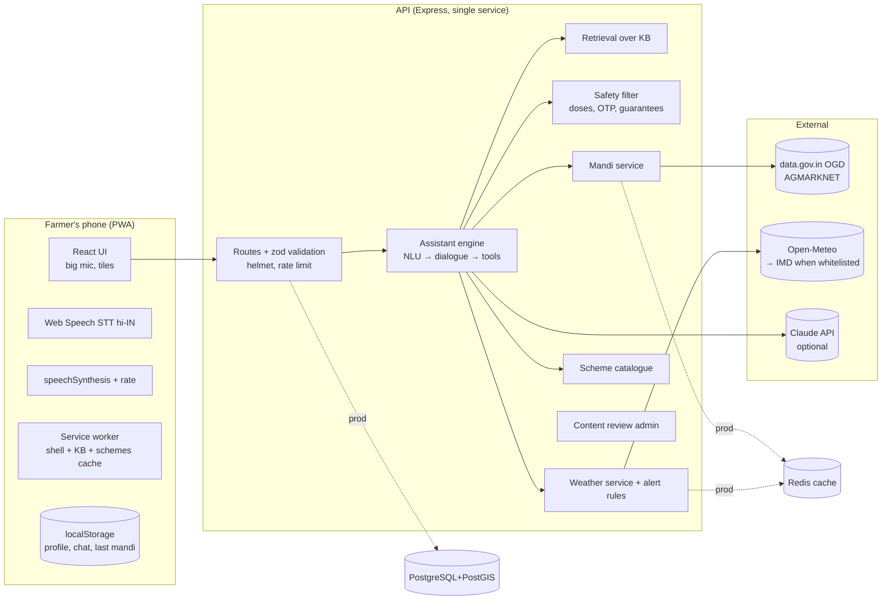

# 8. System Architecture · 11. AI & Voice Architecture

## 8.1 Decisions

| Decision | Choice | Why |
|---|---|---|
| Backend | **Node.js + Express + TypeScript**, a single modular service | Shares types and language with the frontend. Small team. The MVP doesn't need Java's ecosystem. Microservices are not justified |
| Frontend | **React + Vite + TypeScript + Tailwind**, PWA | Installable, works offline, ~86 KB gzipped JS+CSS. (Preact swap is an option if size becomes a problem) |
| Data (prod) | PostgreSQL 16 + PostGIS, Redis, S3-compatible object storage | As specified. The MVP ships in-memory repositories behind the same interfaces so it runs anywhere |
| AI | Provider-independent interfaces (`LlmProvider`, `SpeechToText`, `TextToSpeech`, `WeatherProvider`) | Swap providers after benchmarking without touching business logic |
| Answering | **Template-first**. The LLM is optional and limited to rephrasing retrieved facts | Numbers never pass through the LLM, so prices and weather can't be hallucinated |

## 8.2 Component view

## 8.3 Request flow (assistant)
1. `POST /api/assistant/message {text, lang, sessionId?, context}`. Zod checks the input (max 500 characters, strict context, known district/crop ids).
2. **Credential guard:** mentions of OTP/PIN/password → fraud warning, stop.
3. **NLU** (`nlu.ts`): intent (crop_problem / mandi / weather / scheme / knowledge / greeting / unknown) + slots (crop, district, days, water, land, registration, scheme needs). Uses explicit Devanagari word boundaries (JS `\b` doesn't work for Devanagari).
4. **Dialogue:** a pending intent continues if the new message has no other explicit intent. Missing slots → clarifying question.
5. **Tools:** retrieval (keyword + crop/category boosts; crop-specific entries need their crop to be named), mandi, weather, scheme matcher.
6. **Compose:** template in `hi`/`bho`. For knowledge answers, if an LLM is configured it gets the facts plus the context and must reply in ≤ 90 spoken words.
7. **Safety post-filter** on every answer (`safety.ts`).
8. Reply includes `kind`, `confidence`, `sources[]`, `suggestExpert`, `followUps`.

## 11. AI & voice architecture

### 11.1 LLM usage (optional)
- `ClaudeProvider` uses `@anthropic-ai/sdk`, model `claude-opus-5-5` (env `LLM_MODEL`), effort `low` (short chat answers), server-side refusal fallback enabled (`fallbacks: "default"`). On refusal/error it returns `null`, and the template answer is used.
- System prompt (in `providers/llm.ts`): answer only from FACTS, no doses, no certainty, no promises, never ask for IDs/OTP, simple spoken Bhojpuri/Hindi, ≤ 90 words.
- The safety filter runs again on LLM output. ✅ Tested with a fake LLM that writes a urea dose.
- Answers phrased by the LLM are labelled **"AI द्वारा समझाया गया"**, so they look different from checked knowledge.

### 11.2 RAG
- MVP: 14 curated entries, keyword retrieval (open to inspection, works offline, no embedding cost).
- Scale-up: `knowledge_chunk` table with `pgvector` embeddings plus BM25 hybrid search. Filter by crop, zone, season and stage **before** ranking. Keep `review_status` filtering (exclude `outdated`).

### 11.3 Speech
| Layer | MVP | Target |
|---|---|---|
| STT | Browser Web Speech, `hi-IN` (Chrome on Android uses Google's speech service, so it needs internet) | Server `SpeechToText` provider chosen by benchmark: AI4Bharat IndicConformer fine-tuned on Bhojpuri (SRUTI-style data), Bhashini ULCA, commercial Indic ASR |
| TTS | `speechSynthesis` Hindi voice reads Bhojpuri text; rate 0.9 / slow 0.7; replay | Indic Parler-TTS or similar, after a Bhojpuri listening test. Pre-generated audio for library content |
| Offline | Text library offline. Voice needs the network | On-device small ASR (e.g. a quantised Conformer) for intent-level commands |

### 11.4 Bhojpuri benchmark protocol (must run before choosing a provider)
- **Corpus:** 300+ utterances, at least 40 speakers, 4 Bhojpuri districts (Saran, Bhojpur, Rohtas, W. Champaran), ≥ 40% women, ≥ 30% aged 45+, recorded on low-end phones outdoors. Read prompts and free speech. Real farm words (crop names, *पीयर, लाही, खैरा, बिगहा, कट्ठा*).
- **Metrics:** WER/CER per district and gender. **Intent accuracy** (end-to-end through our NLU). **Slot accuracy** (crop, district, numbers). Latency on 3G.
- **Pass bar for launch:** intent accuracy ≥ 85%, crop-name slot ≥ 90%, no gender gap above 5 points.
- **Consent:** written/recorded consent, audio stored encrypted, used only for evaluation unless the speaker opts in to training.

### 11.5 Adding dialects (Maithili, Magahi, Angika)
`Lang` is a closed union today (`'hi' | 'bho'`). To add a dialect: extend the union, add lexicon variants in `nlu.ts` and `crops.ts`, add `bodyXxx` fields (in production, a `knowledge_translation` table), add templates, benchmark STT. The architecture keeps language data out of the business logic.
