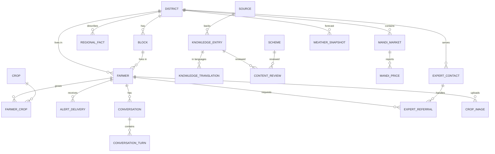

# 9. Database Schema & ER Diagram · 10. API Specification

Full DDL: [`db/schema.sql`](../db/schema.sql). The MVP uses in-memory repositories (`server/src/services/store.ts`) with the same shapes. Move to Postgres by implementing `SessionStore` / `ProfileStore` with `pg`.

## 9.1 ER diagram



Key integrity rules: a `farmer` row exists **only** with `consent_storage_at`. `expert_contact` is shown only when `verified_at IS NOT NULL`. `mandi_price` keeps both `arrival_date` (mandi's date) and `fetched_at` (our date). `knowledge_entry.review_status = 'outdated'` is never retrieved.

## 10. API specification (v0, JSON over HTTPS)

All `/api/*` routes: rate limit 60 req/min/IP, JSON body ≤ 32 KB, zod validation → `400 {error:'invalid_input', issues[]}`.

| Method & path | Purpose | Request | Response |
|---|---|---|---|
| `GET /api/health` | Liveness + which integrations are configured | – | `{ok, integrations:{mandi, weather, llm, stt}}` |
| `GET /api/meta` | Districts (38, with zone) and crops | – | `{season, districts[], crops[]}` |
| `POST /api/assistant/message` | Conversational turn | `{text (1–500), lang:'hi'\|'bho', sessionId?: uuid, context?: {district, block, village, landAcres, crops[], irrigation, soil}}` (strict) | `{sessionId, reply:{text, lang, kind, confidence, followUps[], sources[{title,url,lastUpdated,status?}], suggestExpert, intent, data?}}` |
| `GET /api/mandi?crop=&district=` | Mandi prices near a district | crop id required | `{status:'ok'\|'no_records'\|'unavailable', reason?, records[{market,district,commodity,variety,arrivalDate,minPrice,maxPrice,modalPrice}], latestArrivalDate, stale, fetchedAt, fromCache, source, unit, disclaimerHi}` |
| `GET /api/weather?district=` | District forecast + advisories | district id | `{status, district, granularity:'district_hq_point', provider{name,url,official:false}, officialWarningsUrl, fetchedAt, snapshot{current, daily[5]}, alerts[{id,severity,titleHi,adviceHi,adviceBho}]}` |
| `GET /api/schemes` · `/api/schemes/:id` | Scheme catalogue | – | `{schemes[]}` / scheme |
| `GET /api/knowledge?crop=` | Knowledge library (non-outdated) | – | `{items[]}` |
| `POST /api/profile` | Store profile **with consent** | `{preferredLang, consentDataStorage: true, …context, name?, id?}` (strict – unknown fields such as `aadhaar` → 400) | `201` profile |
| `GET/DELETE /api/profile/:id` | Read / erase | – | profile / `204` |
| `POST /api/voice/stt` | Server STT (reserved) | audio | `501 {error:'server_stt_not_configured'}` until benchmark |
| `GET /api/admin/content` | Review queue | `Authorization: Bearer <ADMIN_TOKEN>` (≥ 12 chars, constant-time compare) | knowledge + scheme verification + review log |
| `POST /api/admin/content/:id/review` | Expert sign-off | `{status, reviewer, note?}` | review record |

**Reply `kind` values:** `data` (official dataset), `knowledge` (curated KB), `ai_explanation` (LLM-phrased from KB), `clarifying_question`, `no_data`, `safety`.

**Example**
```http
POST /api/assistant/message
{"text":"आज मुजफ्फरपुर में मक्का का भाव का बा?","lang":"bho"}
→ 200 {"sessionId":"…","reply":{"kind":"no_data","confidence":"low",
  "text":"माफ करीं, अभी मकई के मंडी भाव ना मिल पावत बा (सरकारी डेटा से जुड़ाव नइखे)। हम अंदाजा से भाव ना बताइला। …",
  "sources":[{"title":"AGMARKNET … via data.gov.in","url":"https://data.gov.in/…","lastUpdated":"उपलब्ध नहीं"}], …}}
```

**Versioning plan:** prefix `/api/v1` before public pilot. Add an OpenAPI document generated from the zod schemas (`zod-to-openapi`).
